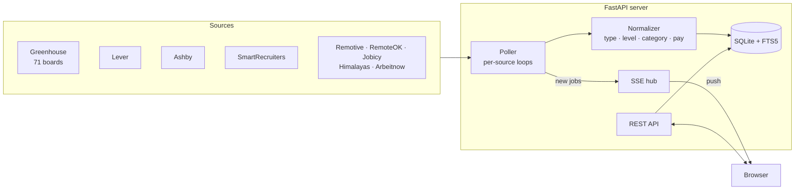

# JobRadar

**Live job listings from 1,100+ companies, pushed to your browser within a minute of being posted.**

Most job sites show a role hours or days after the company posts it. JobRadar watches companies' own career boards (Greenhouse, Lever, Ashby, SmartRecruiters) directly, along with five public job boards. It checks them every 45 seconds and streams new postings to every open browser the moment they appear.

## Features

**Live job feed**
- ~22,000 live listings from 1,100+ companies across 9 sources, refreshed continuously
- New jobs appear in the list instantly (Server-Sent Events): no refresh, no polling from the browser
- Company boards are checked every **45 s**, so a new posting reaches you in about a minute or less
- Closed postings are removed as soon as a company takes them down

**Search and filters**
- Full-text search (SQLite FTS5) with "best match" ranking that weights title matches highest
- Filter by **job type** (Full-time, Part-time, Internship, Apprenticeship, Seasonal, Temporary, Contract), **category** (16), **experience level**, **company**, **department**, **location**, remote/on-site, date posted, and "shows pay"
- Live facet counts on every filter; filters live in the URL, so any search can be bookmarked or shared

**Everything before you click away**
- A detail panel with the full description, pay, location, work arrangement, job type, level, department and posting date
- "From the posting" facts pulled out automatically: years of experience, education, visa sponsorship, schedule, start date, deadline and benefits
- Pay ranges extracted from the posting text when the source doesn't provide them (about half of all listings)

**Alerts and tracking**
- Saved-search alerts with desktop notifications when a matching job is posted
- Save jobs and track each application through Saved → Applied → Interviewing → Offer

## Architecture



| Piece | What it does |
|---|---|
| [`app/sources.py`](app/sources.py) | One fetcher per source. Greenhouse uses a light "list only" request each cycle and fetches full details only for new job IDs, so a check of all 71 boards takes about 1 second. |
| [`app/poller.py`](app/poller.py) | One async loop per source on its own interval. It diffs against the DB, removes closed postings, and publishes new ones to the SSE hub. |
| [`app/normalize.py`](app/normalize.py) | Maps every source onto one schema: job type, level, remote, pay, and key facts. |
| [`app/categorize.py`](app/categorize.py) | Rule-based classifier into 16 categories, from the title first and then source hints. |
| [`app/db.py`](app/db.py) | SQLite with WAL, indexes, an FTS5 index kept in sync by triggers, and faceted counts. |
| [`static/`](static) | Vanilla JS single-page app with no build step: hash routing, SSE client and streaming fetch. |

**Design choices**
- **Company boards over aggregators.** Greenhouse, Lever and Ashby publish a job the instant the company does, so watching them directly is what makes JobRadar early.
- **Push, not pull.** One server-side poller serves every user, and browsers receive new jobs over a single SSE connection.
- **No build step.** The frontend is about 1,350 lines of plain HTML/CSS/JS, so anyone can read it and it deploys anywhere.

## Run it locally

Requires Python 3.9+.

```bash
python3 -m venv .venv
source .venv/bin/activate
pip install -r requirements.txt
uvicorn app.main:app --port 8000
```

Open http://localhost:8000. The first sync takes about 30 seconds; jobs then stream in continuously.

### Configuration (`.env`)

| Variable | Default | Purpose |
|---|---|---|
| `GREENHOUSE_BOARDS`, `LEVER_BOARDS`, `ASHBY_BOARDS`, `SMARTRECRUITERS_COMPANIES` | built-in list | Which company career boards to watch (comma-separated slugs) |
| `MAX_JOB_AGE_DAYS` | `45` | Age cutoff for job-board feeds (company boards keep a job while it's open) |

To watch another company, find its board slug in its careers URL (`boards.greenhouse.io/<slug>`, `jobs.lever.co/<slug>`, `jobs.ashbyhq.com/<slug>`) and add it.

## Deploy

The app is one process (the poller runs inside the web server), so deploy it as a single always-on instance with a persistent disk for the SQLite file:

```bash
docker build -t jobradar .
docker run -p 8000:8000 -v jobradar-data:/data jobradar
```

## API

| Endpoint | Description |
|---|---|
| `GET /api/jobs` | Search with filters (`q`, `job_type`, `category`, `level`, `company`, `department`, `source` take `\|`-separated values; plus `location`, `remote`, `posted_within_hours`, `salary_only`, `sort`, `limit`, `offset`); returns jobs and facet counts |
| `GET /api/jobs/{id}` | Full job, including description, pay and extracted facts |
| `GET /api/stream` | Server-Sent Events: `{type: "new_jobs", jobs: [...]}` as they're discovered |
| `GET /api/meta` | Stats, taxonomy and per-source health |

## Limitations

- Coverage is the set of watched boards and public feeds, not every job on the internet. LinkedIn and Indeed don't offer public APIs, so they aren't included.
- Seasonal and apprenticeship roles are seasonal by nature; expect more of them in spring and before the holidays.
- Alerts notify you while JobRadar is open in a browser tab (email or SMS alerts would be a natural next step).
- Category, level and job type are inferred with rules, which are good but not perfect.

## Tech

