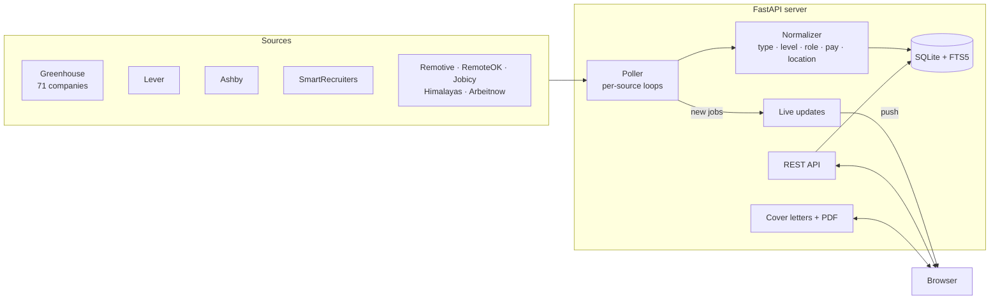

# PostedFresh

**Fresh job listings from thousands of employers, from Target and CVS to OpenAI and Stripe, on your screen within a minute of being posted. Free to use.**


Most job sites show a role hours or days after the company posts it. PostedFresh watches employers' own career sites directly (Greenhouse, Lever, Ashby, SmartRecruiters, Workday and Amazon), along with five public job boards. The newest postings are checked every 45–90 seconds and pushed to every open browser the moment they appear.

## Features

**Live job feed**
- Tens of thousands of open listings from thousands of companies across 11 sources, including big employers students look for, like Target, CVS Health, Home Depot, Nike, Nordstrom, T-Mobile, Amazon and the major banks
- Every source gets a **quick check for its newest jobs about once a minute**, plus a deeper sweep; the biggest feeds (120,000+ remote jobs on Himalayas, 10,000 at Amazon) are filled in gradually so no server is overloaded
- New jobs appear at the top of the list automatically, with no refresh needed (Server-Sent Events)
- Closed postings are removed when a company takes them down, and **duplicates are hidden**: a job listed twice, or on both a company site and a job board, shows once (the company's own listing wins)
- **Honest freshness:** sources that only give a date show "Today" or "Yesterday"; the green "just posted" badge is only for jobs PostedFresh actually saw appear
- A **"Just posted" ticker** under the search bar slides in each new job the moment it's found
- **Freshness badges** glow green for jobs posted minutes ago and fade to gray as a job ages
- **Real company logos**, fetched once per company and cached on the server

**Simple, accurate filters**
- One search box with ranked, full-text search (SQLite FTS5)
- A filter sidebar with collapsible sections: location, date posted, job type, role, experience, work setting, company and pay
- **31 roles** to find your niche, from Analyst, Consulting, Product Management and Project & Program Management to Data Engineering, Cybersecurity, Skilled Trades, Healthcare, Retail & Hospitality and Fitness & Wellness, each searchable
- **Accurate job types:** the title decides, so new-grad, early-career and graduate-program jobs are filed as full-time entry-level roles, never as internships, while real internships are recognized in ten languages
- **Job types:** Full-time, Part-time, Internship, Apprenticeship, Fellowship, Seasonal, Temporary, Contract, Freelance, Volunteer
- **Work setting:** Remote, Hybrid or On-site
- **Requirements & pay:** jobs that list pay, jobs that **offer visa sponsorship** (read sentence by sentence, so "we can't sponsor" never counts as yes), and jobs where **no degree is required**
- **Location** is a searchable dropdown. Messy location text from every source ("New York, NY (HQ)", "US-CA-Menlo Park", "bangalore, , India") is cleaned into city, state and country, so choosing "Texas, USA" finds every job in any Texas city.
- Filters live in the URL, so any search can be bookmarked or shared

**Everything before you click away**
- A detail panel with pay, location, job type, experience level, work setting, posting date and the full description
- Highlights pulled from the posting: years of experience, education, visa sponsorship, schedule, start date, deadline and benefits
- Pay ranges found in the posting text when the source doesn't provide them

**Free cover letters**
- Paste or upload a resume (PDF, Word or text), pick any job, and get an editable cover letter as a downloadable PDF
- Built entirely on the server from your own resume: it finds the skills you share with the posting, turns your strongest resume bullets into sentences, and never adds anything that isn't on your resume
- No accounts, no paid services; the resume stays in your browser

**Saved jobs and alerts**
- Save jobs and track each application: Saved, Applied, Interviewing, Offer
- Turn any search into an alert and get a desktop notification when a matching job is posted

## Architecture



| File | What it does |
|---|---|
| [`app/worker.py`](app/worker.py) | The collector: runs next to the website as its own process (started automatically), so reading thousands of postings never slows down a visitor's search. It saves jobs, "just posted" announcements and source health to the database, which the website reads. |
| [`app/feeds.py`](app/feeds.py) | The large sources (Himalayas, Arbeitnow, Jobicy, Amazon and 35 employers on Workday), each with a once-a-minute check for the newest jobs and a sweep that continues where it left off. |
| [`app/sources.py`](app/sources.py) | One fetcher per source. Greenhouse uses a light "list only" request each cycle and fetches full details only for new jobs, so a check of all 71 companies takes about a second. |
| [`app/poller.py`](app/poller.py) | One loop per source on its own schedule. It finds new and closed jobs and pushes new ones to browsers. |
| [`app/locations.py`](app/locations.py) | Parses messy location text into city, state/region and country (about 95% of listings), which powers the location dropdown. |
| [`app/normalize.py`](app/normalize.py) | Maps every source onto one format: job type, experience level, remote, pay and highlights. |
| [`app/categorize.py`](app/categorize.py) | Sorts jobs into 31 roles (Analyst, Consulting, Product Management, Project & Program Management, Data Engineering, Skilled Trades and more) from the title, with common terms in six languages, falling back to the team's own labels. |
| [`app/db.py`](app/db.py) | SQLite storage with full-text search, per-job places and filter counts. |
| [`app/logos.py`](app/logos.py) | Maps each watched company to its website and serves its logo, downloaded once and cached. |
| [`app/letter.py`](app/letter.py) | Resume reading, skill matching, the cover letter builder and PDF output. |
| [`static/`](static) | Plain HTML, CSS and JavaScript, with no build step. |

**Design choices**
- **Company career pages over aggregators.** Companies publish there first, which is what makes PostedFresh early.
- **Push, not refresh.** One collector serves everyone, and browsers get new jobs over a single live connection.
- **Collecting and serving are separate.** The website only answers visitors; typical searches over 60,000+ jobs return in well under half a second, with counts for popular views kept ready in advance.
- **Free to run.** No paid APIs or keys: every feature runs on the server itself.
- **No build step.** Anyone can read the frontend, and it deploys anywhere.

## Run it locally

Requires Python 3.9+.

```bash
python3 -m venv .venv
source .venv/bin/activate
pip install -r requirements.txt
uvicorn app.main:app --port 8000
```

Open http://localhost:8000. The first sync takes about 30 seconds; after that, new jobs stream in continuously.

### Configuration (optional `.env`)

| Variable | Default | Purpose |
|---|---|---|
| `GREENHOUSE_BOARDS`, `LEVER_BOARDS`, `ASHBY_BOARDS`, `SMARTRECRUITERS_COMPANIES` | built-in list | Which company career pages to watch (comma-separated) |
| `MAX_JOB_AGE_DAYS` | `45` | Age cutoff for job-board feeds (company pages keep a job while it's open) |

To watch another company, find its slug in its careers URL (`boards.greenhouse.io/<slug>`, `jobs.lever.co/<slug>`, `jobs.ashbyhq.com/<slug>`) and add it.

## Deploy

The poller runs inside the web server, so deploy it as a single always-on instance with a persistent disk for the SQLite file:

```bash
docker build -t postedfresh .
docker run -p 8000:8000 -v postedfresh-data:/data postedfresh
```

## API

| Endpoint | Description |
|---|---|
| `GET /api/jobs` | Search with filters (`q`, `place`, `job_type`, `category`, `level`, `company` take `\|`-separated values; plus `remote` (remote/hybrid/onsite), `posted_within_hours`, `salary_only`, `visa`, `no_degree`, `sort`, `limit`, `offset`); returns jobs and filter counts (`facets=false` skips the counts) |
| `GET /api/facets` | Just the filter counts for the same filters, so the page can show jobs first |
| `GET /api/jobs/{id}` | One job, with description, pay and highlights |
| `GET /api/stream` | Live updates: `{type: "new_jobs", jobs: [...]}` as they're found |
| `GET /api/meta` | Stats, filter options and the status of each source |
| `POST /api/cover-letter` | Builds a cover letter from a resume and a job |
| `POST /api/cover-letter/pdf` | Turns the letter text into a PDF |
| `POST /api/resume/parse` | Reads text from an uploaded PDF, Word or text resume |


## Limitations

- Coverage is the set of watched companies and public job boards, not every job on the internet. LinkedIn and Indeed don't offer public access, so they aren't included.
- Seasonal and apprenticeship roles come and go with the time of year.
- Alerts notify you while PostedFresh is open in a browser tab.
- Visa sponsorship and degree requirements are read from the posting text; many postings don't mention either, so those filters show only jobs that say so explicitly.
- Roles, job types and experience levels are inferred from each posting, which is accurate for most jobs but not all.

## Tech

Python · FastAPI · asyncio · httpx · SQLite (FTS5) · Server-Sent Events · fpdf2 · vanilla JavaScript · CSS
