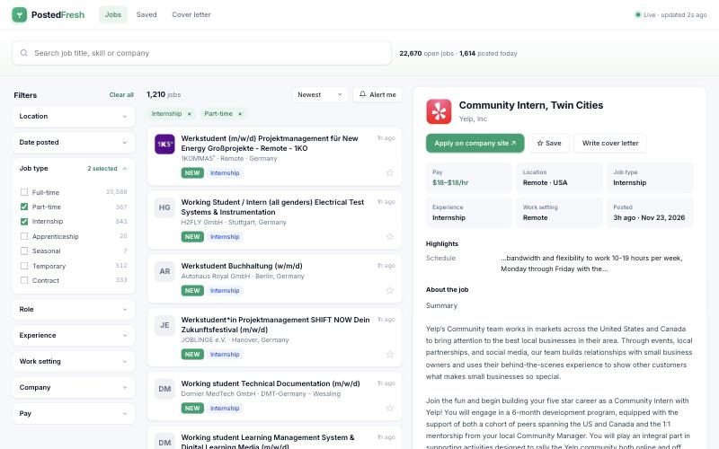
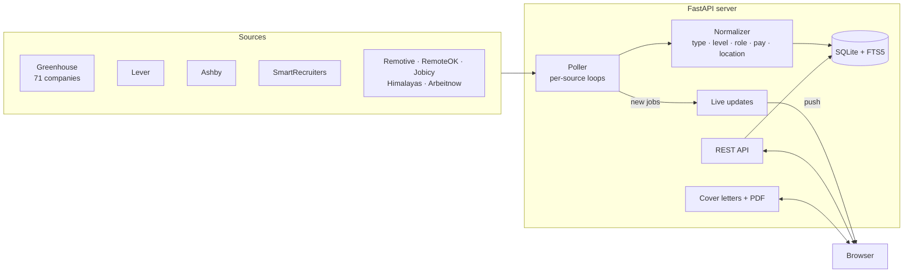
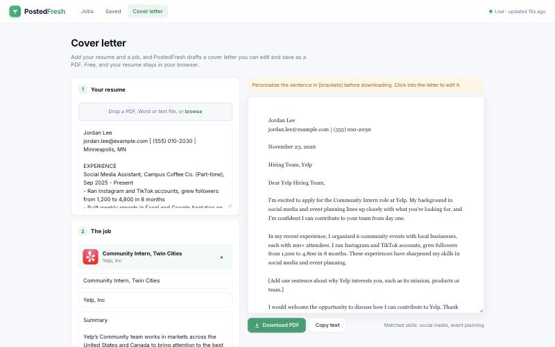

# PostedFresh

**Fresh job listings from 1,100+ company career pages, on your screen within a minute of being posted. Free to use.**



Most job sites show a role hours or days after the company posts it. PostedFresh watches companies' own career pages directly (Greenhouse, Lever, Ashby and SmartRecruiters), along with five public job boards. It checks them every 45 seconds and pushes new postings to every open browser the moment they appear.

## Features

**Live job feed**
- ~22,000 open listings from 1,100+ companies across 9 sources
- New jobs appear at the top of the list automatically, with no refresh needed (Server-Sent Events)
- Company career pages are checked every 45 seconds; closed postings are removed when a company takes them down

**Simple, accurate filters**
- One search box with ranked, full-text search (SQLite FTS5)
- A filter sidebar with collapsible sections: location, date posted, job type, role, experience, work setting, company and pay
- **Job types:** Full-time, Part-time, Internship, Apprenticeship, Seasonal, Temporary, Contract
- **Location** is a searchable dropdown. Messy location text from every source ("New York, NY (HQ)", "US-CA-Menlo Park", "bangalore, , India") is cleaned into city, state and country, so choosing "Texas, USA" finds every job in any Texas city.
- Filters live in the URL, so any search can be bookmarked or shared

**Everything before you click away**
- A detail panel with pay, location, job type, experience level, work setting, posting date and the full description
- Highlights pulled from the posting: years of experience, education, visa sponsorship, schedule, start date, deadline and benefits
- Pay ranges found in the posting text when the source doesn't provide them

**Free cover letters**
- Paste or upload a resume (PDF, Word or text), pick any job, and get an editable cover letter as a downloadable PDF
- Built entirely on the server from your own resume: it finds the skills you share with the posting, turns your strongest resume bullets into sentences, and never adds anything that isn't on your resume
- No accounts, no paid services; the resume stays in your browser

**Saved jobs and alerts**
- Save jobs and track each application: Saved, Applied, Interviewing, Offer
- Turn any search into an alert and get a desktop notification when a matching job is posted

## Architecture



| File | What it does |
|---|---|
| [`app/sources.py`](app/sources.py) | One fetcher per source. Greenhouse uses a light "list only" request each cycle and fetches full details only for new jobs, so a check of all 71 companies takes about a second. |
| [`app/poller.py`](app/poller.py) | One loop per source on its own schedule. It finds new and closed jobs and pushes new ones to browsers. |
| [`app/locations.py`](app/locations.py) | Parses messy location text into city, state/region and country (about 95% of listings), which powers the location dropdown. |
| [`app/normalize.py`](app/normalize.py) | Maps every source onto one format: job type, experience level, remote, pay and highlights. |
| [`app/categorize.py`](app/categorize.py) | Sorts jobs into 16 roles from the title, falling back to the source's own labels. |
| [`app/db.py`](app/db.py) | SQLite storage with full-text search, per-job places and filter counts. |
| [`app/letter.py`](app/letter.py) | Resume reading, skill matching, the cover letter builder and PDF output. |
| [`static/`](static) | Plain HTML, CSS and JavaScript, with no build step. |

**Design choices**
- **Company career pages over aggregators.** Companies publish there first, which is what makes PostedFresh early.
- **Push, not refresh.** One server-side poller serves everyone, and browsers get new jobs over a single live connection.
- **Free to run.** No paid APIs or keys: every feature runs on the server itself.
- **No build step.** Anyone can read the frontend, and it deploys anywhere.

## Run it locally

Requires Python 3.9+.

```bash
python3 -m venv .venv
source .venv/bin/activate
pip install -r requirements.txt
uvicorn app.main:app --port 8000
```

Open http://localhost:8000. The first sync takes about 30 seconds; after that, new jobs stream in continuously.

### Configuration (optional `.env`)

| Variable | Default | Purpose |
|---|---|---|
| `GREENHOUSE_BOARDS`, `LEVER_BOARDS`, `ASHBY_BOARDS`, `SMARTRECRUITERS_COMPANIES` | built-in list | Which company career pages to watch (comma-separated) |
| `MAX_JOB_AGE_DAYS` | `45` | Age cutoff for job-board feeds (company pages keep a job while it's open) |

To watch another company, find its slug in its careers URL (`boards.greenhouse.io/<slug>`, `jobs.lever.co/<slug>`, `jobs.ashbyhq.com/<slug>`) and add it.

## Deploy

The poller runs inside the web server, so deploy it as a single always-on instance with a persistent disk for the SQLite file:

```bash
docker build -t postedfresh .
docker run -p 8000:8000 -v postedfresh-data:/data postedfresh
```

## API

| Endpoint | Description |
|---|---|
| `GET /api/jobs` | Search with filters (`q`, `place`, `job_type`, `category`, `level`, `company` take `\|`-separated values; plus `remote`, `posted_within_hours`, `salary_only`, `sort`, `limit`, `offset`); returns jobs and filter counts |
| `GET /api/jobs/{id}` | One job, with description, pay and highlights |
| `GET /api/stream` | Live updates: `{type: "new_jobs", jobs: [...]}` as they're found |
| `GET /api/meta` | Stats, filter options and the status of each source |
| `POST /api/cover-letter` | Builds a cover letter from a resume and a job |
| `POST /api/cover-letter/pdf` | Turns the letter text into a PDF |
| `POST /api/resume/parse` | Reads text from an uploaded PDF, Word or text resume |



## Limitations

- Coverage is the set of watched companies and public job boards, not every job on the internet. LinkedIn and Indeed don't offer public access, so they aren't included.
- Seasonal and apprenticeship roles come and go with the time of year.
- Alerts notify you while PostedFresh is open in a browser tab.
- Roles, job types and experience levels are inferred from each posting, which is accurate for most jobs but not all.

## Tech

Python · FastAPI · asyncio · httpx · SQLite (FTS5) · Server-Sent Events · fpdf2 · vanilla JavaScript · CSS
